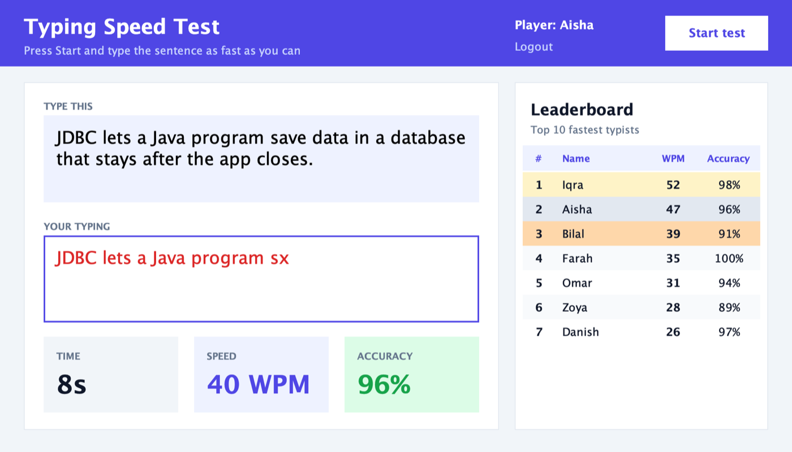
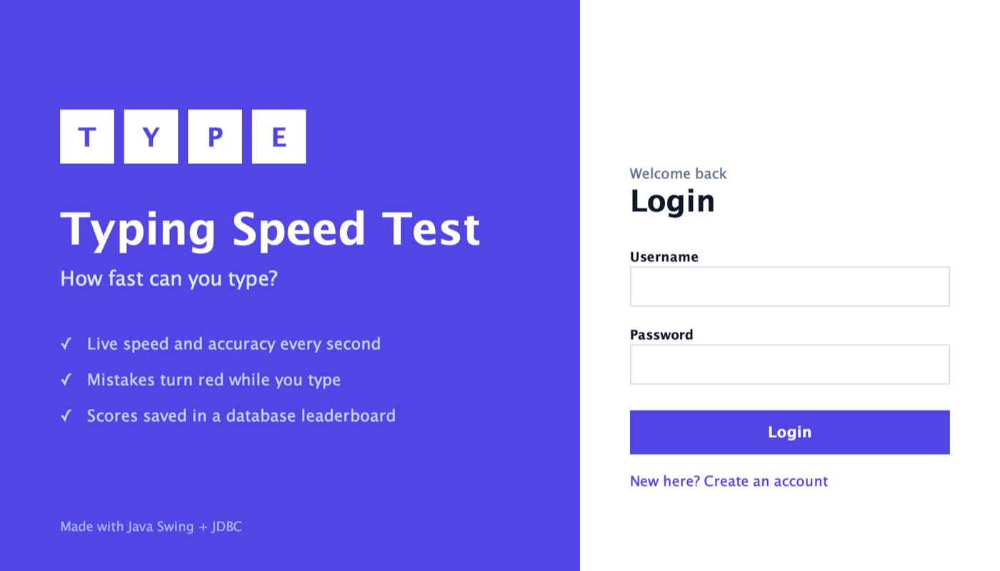
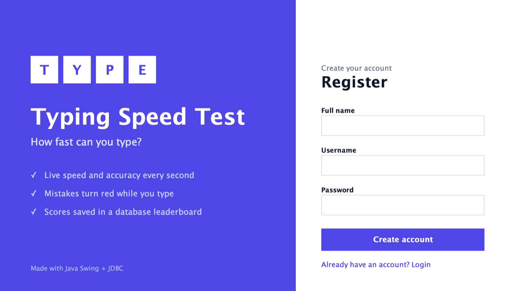

<p align="center">
  
</p>

<h1 align="center">Typing Speed Test</h1>

<p align="center">
  A desktop typing test made with <b>Java Swing</b> and <b>JDBC (SQLite)</b>.<br>
  Log in, type a sentence as fast as you can, and get on the leaderboard.
</p>

<p align="center">
  
</p>

## Features

- **Login and register** with accounts saved in a database
- **Random sentence** for every test
- **Live results** every second: time, speed (WPM) and accuracy
- **Mistakes turn red** while you type
- **Leaderboard** of the 10 fastest scores, with gold, silver and bronze rows
- Beginner-friendly code: plain Swing, `null` layout with `setBounds`, `ActionListener` / `KeyListener`, and JDBC with `PreparedStatement`

| Login | Register |
|---|---|
|  |  |

## Download and run (Windows)

1. Download [`dist/TypingSpeedTest.exe`](dist/TypingSpeedTest.exe).
2. Double-click it. You need **Java 8 or newer** installed. If Java is missing, the app offers a download link.
3. The first time, Windows may show *"Windows protected your PC"* because the exe is not signed. Click **More info → Run anyway**.

The database file `scores.db` is created in the same folder as the exe.

## Run from the source code

You need a JDK (Java 8 or newer). Inside this folder:

**Mac / Linux**
```bash
javac -cp lib/sqlite-jdbc-3.47.1.0.jar *.java
java -cp .:lib/sqlite-jdbc-3.47.1.0.jar Login
```

**Windows**
```bat
javac -cp lib\sqlite-jdbc-3.47.1.0.jar *.java
java -cp .;lib\sqlite-jdbc-3.47.1.0.jar Login
```

If you see `No suitable driver found for jdbc:sqlite:scores.db`, the jar in `lib` is missing from the classpath (`-cp`).

**NetBeans:** create a *Java with Ant → Java Application* project (untick "Create Main Class"), copy the three `.java` files into `src`, add `lib/sqlite-jdbc-3.47.1.0.jar` under **Libraries → Add JAR/Folder**, set the main class to `Login`, and press Run.

## Files

| File | What it does |
|---|---|
| `Login.java` | First window: login and register forms, colours and helper methods (`makeLabel`, `makeField`, `makeButton`, `makeLink`). Has `main`. |
| `TypingTest.java` | The test: sentence, typing box, timer, results, leaderboard. Also has `ScoreRenderer`, which colours the leaderboard rows. |
| `DB.java` | Connects to `scores.db` and creates the `users` and `scores` tables. |
| `lib/sqlite-jdbc-3.47.1.0.jar` | SQLite JDBC driver. |
| `dist/TypingSpeedTest.exe` | Windows app (the code above, packed into one exe). |
| `icon/app.ico` | App icon. |

## How the numbers are worked out

- **Speed (WPM)** = (letters typed ÷ 5) ÷ minutes. Typing tests count 1 word as 5 letters.
- **Accuracy** = letters that match the sentence × 100 ÷ letters typed.
- The test ends when you have typed as many letters as the sentence.

## Database

| Table | Columns |
|---|---|
| `users` | `username` (primary key), `name`, `password` |
| `scores` | `name`, `wpm`, `accuracy` |

Passwords are stored as plain text to keep the example simple. A real app should store hashed passwords.

## Built with

- Java Swing and AWT
- JDBC with [SQLite JDBC](https://github.com/xerial/sqlite-jdbc) (Apache License 2.0)
- The exe was made with [Launch4j](https://launch4j.sourceforge.net/)
